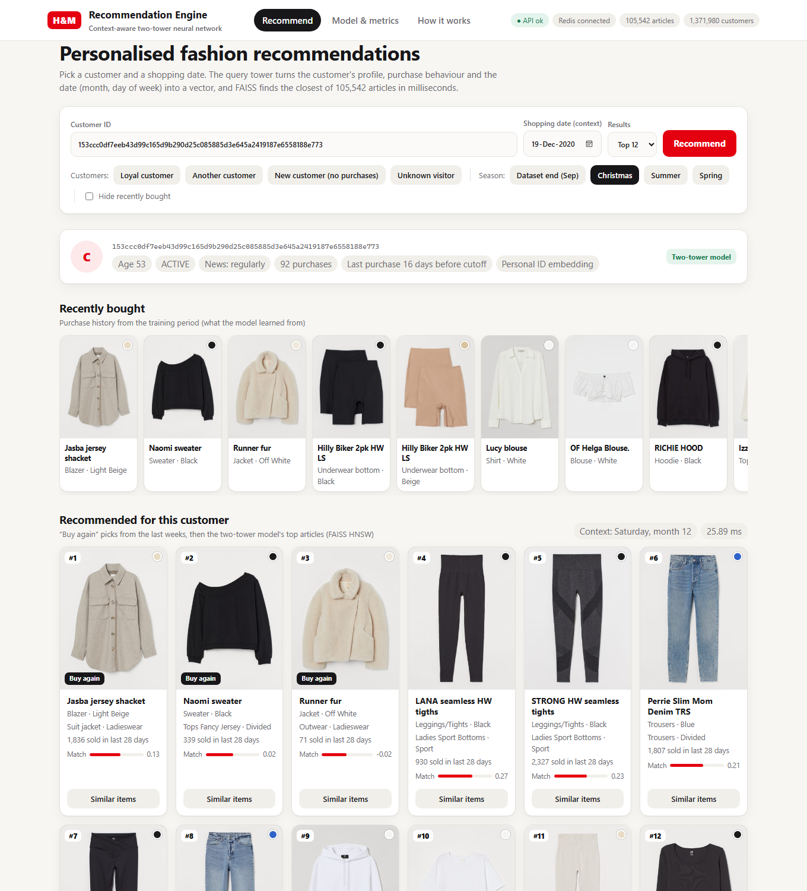
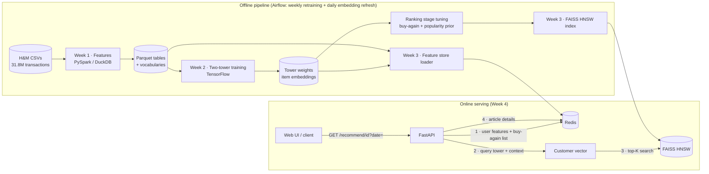

# H&M Context-Aware Neural Recommendation Engine

A deep learning recommender for the **H&M Personalized Fashion Recommendations** dataset (Kaggle).
A **two-tower neural network** learns from customer metadata, purchase history, purchase context
(month, day of week) and article metadata. It serves personalised **top-K recommendations in
milliseconds** through a **Redis feature store**, **FAISS approximate nearest-neighbour search** and a
**FastAPI** microservice with a web UI. **Apache Airflow** retrains it weekly and refreshes the embeddings daily.

**Tech stack:** Python · PySpark / DuckDB · TensorFlow / Keras · FAISS · Redis · FastAPI · Apache Airflow · Docker



## Results

Trained on the last 12 weeks of real H&M transactions. Evaluated on the **held-out last week**
(2020-09-16 to 2020-09-22) against the **full catalogue of 105,542 articles**. Every ranking setting
was chosen on the validation week first, and the test week was used only once:

| Variant (test week) | MAP@12 | Recall@12 | NDCG@12 |
|---|---|---|---|
| **Served system:** buy-again (last 28 days) + two-tower model (+ popularity prior) | **0.0235** | **0.0446** | **0.0330** |
| Two-tower model only | 0.0054 | 0.0156 | 0.0096 |
| Buy-again + most popular (no neural model) | 0.0244 | 0.0479 | 0.0350 |
| Most popular articles of the last 28 days (baseline) | 0.0055 | 0.0193 | 0.0112 |

The served system is **4.3× the popularity baseline** on MAP@12. The neural model is what
personalises the list for the 54.9% of test customers who bought nothing in the 4 weeks before
the test week (8.1% have no purchase history at all), and adapts it to the shopping date.

**What we learned:** repurchase is the strongest single signal in this dataset. On the validation
week, filling the remaining slots with the two-tower model beat filling them with popular items
(MAP@12 0.0273 vs 0.0247). On the test week, the popular fill was slightly better (0.0244 vs 0.0235).
We report it as it is instead of tuning on the test week. The next step would be a learned ranker
(e.g. LightGBM) that combines both candidate sources.

Training details: 3.1M interactions, 36.6 min on a laptop CPU, best of 4 epochs by validation loss.
FAISS HNSW: recall@12 = 0.972 vs exact search.

<!-- RESULTS:START -->
**API under load** (`tests/stress_test.py`: real customers + 10% unknown visitors, Redis + TensorFlow + FAISS, one uvicorn worker on a laptop):

| Concurrent users | Requests | Errors | Throughput | p50 | p95 | p99 |
|---|---|---|---|---|---|---|
| 1 | 500 | 0 | 138 req/s | 6.7 ms | 12.0 ms | 16.0 ms |
| 10 | 500 | 0 | 302 req/s | 32.6 ms | 43.5 ms | 55.9 ms |
| 25 | 500 | 0 | 226 req/s | 84.7 ms | 139.1 ms | 604.5 ms |
| 50 | 500 | 0 | 298 req/s | 160.4 ms | 197.0 ms | 421.8 ms |
<!-- RESULTS:END -->

Full report: [`artifacts/EVALUATION_REPORT.md`](artifacts/EVALUATION_REPORT.md) · raw numbers:
[`artifacts/evaluation_metrics.json`](artifacts/evaluation_metrics.json) · load test:
[`artifacts/stress_test_results.json`](artifacts/stress_test_results.json)

## Features
- **Two-stage recommendations:** "buy again" candidates (articles bought in the last 28 days), then the
  two-tower model's top articles, ranked by similarity plus a recent-popularity prior. The FAISS index
  stores the prior as one extra dimension, so this is a single ANN search.
- **Context-aware:** the shopping date (month, day of week) is an input of the query tower. Pick
  *Christmas* or *Summer* in the UI and the recommendations change.
- **Cold start handled three ways:** customers with history get their own ID embedding.
  Customers with no purchases get a profile-based embedding (a trained "unknown user" vector plus age,
  club status, etc.). Visitors who aren't in the feature store get trending articles.
- **Fast serving:** a Redis profile lookup takes under 1 ms and a FAISS HNSW search 0.04 ms, with
  97% recall vs exact search. A full recommendation takes ~7 ms end to end (p50, single user).
- **Web UI** (`/ui`): customer profile, recent purchases with product photos, recommendations with
  match scores, "similar items", model metrics and training curves, and live API latency.
- **Production pipeline:** Airflow DAGs for weekly retraining and daily embedding refresh, Docker
  Compose deployment, and automated tests plus a concurrent load test.

## Architecture


**Model.** *Query tower:* customer ID embedding, club status, fashion-news frequency, age, purchase
statistics (count, unique items, average price, recency), new-customer flag, plus **context** (month,
day of week). *Candidate tower:* article ID embedding, product type, colour, department, garment group,
7-day / 28-day / all-time popularity, new-article flag. Both towers output L2-normalised 64-d vectors,
trained with an **in-batch softmax loss (negative sampling) with logQ correction** and early stopping.
IDs are randomly hidden during training, so the "unknown" embeddings learn to handle new customers and
new articles.

> The brief lists TensorFlow Recommenders (TFRS). The towers are written in plain TensorFlow / Keras
> because TFRS doesn't support Keras 3, which current TensorFlow ships with. The retrieval loss
> (in-batch softmax) is the same one TFRS uses.

---

## Quick start (local machine: Windows, macOS or Linux)

**You need:** Python 3.10–3.13, about 8 GB RAM, 5 GB free disk, and [Docker Desktop](https://www.docker.com/products/docker-desktop/)
for Redis (optional, see step 4).

### 1. Install
```bash
git clone https://github.com/afnakurikkal/hm-recommendation-engine.git
cd hm-recommendation-engine
python -m venv .venv
# Windows:        .venv\Scripts\activate
# macOS / Linux:  source .venv/bin/activate
pip install -r requirements.txt
```

### 2. Check that everything works (1 minute, no dataset needed)
```bash
python -m pytest tests/test_pipeline.py -v
```
This runs the **whole system end to end** on a small synthetic dataset: data, training, evaluation,
FAISS index, feature store and every API endpoint (17 tests).

### 3. Get the data and build the model (about 1 hour on a laptop CPU)
Download the dataset from the [Kaggle competition page](https://www.kaggle.com/competitions/h-and-m-personalized-fashion-recommendations/data)
("Download All", accept the competition rules first), or with the Kaggle CLI:
```bash
kaggle competitions download -c h-and-m-personalized-fashion-recommendations
```
Then run the whole offline pipeline with one command. Leave the zip as it is: it is read directly,
and the product photos inside it are used by the web UI.
```bash
docker compose up -d redis
python scripts/run_pipeline.py --source path/to/h-and-m-personalized-fashion-recommendations.zip
```
| Step | What it does | Time* |
|------|--------------|-------|
| `data` | Week 1: 31.8M transactions → cleaned features, time split, vocabularies (`data/hm_project/`) | ~3 min |
| `train` | Week 2: trains + evaluates the two-tower model, exports embeddings, writes `artifacts/` | ~37 min |
| `rank` | Week 2: tunes the ranking stage (buy-again window, popularity weight) on the validation week, final test metrics | ~10 min |
| `index` | Week 3: FAISS HNSW index over 105,542 article vectors + accuracy/speed benchmark | ~1 min |
| `store` | Week 3: loads 1.37M customers + 105k articles into Redis (1.07 GB) | ~2 min |

\*measured on a 12-thread laptop CPU with 8 GB RAM. Run a single step with e.g. `--steps train,index`.

### 4. Start the API and open the web UI
```bash
uvicorn src.api.main:app --port 8000
```
Open **http://localhost:8000**. It redirects to the web UI at `/ui`. Interactive API docs are at
**http://localhost:8000/docs**.

**No Docker?** Use the in-process feature store instead of Redis. The API loads a sample of customers
itself at start-up (skip the `store` step):
```bash
# Windows PowerShell:  $env:REDIS_URL="memory://"; $env:HM_MAX_USERS="100000"
# macOS / Linux:       export REDIS_URL=memory:// HM_MAX_USERS=100000
uvicorn src.api.main:app --port 8000
```

### 5. Tests and load test (with the API running)
```bash
python -m pytest -v              # offline end-to-end tests + live tests against the running API
python -m tests.stress_test      # concurrent load: throughput and p50 / p95 / p99 latency
```

### Run everything in Docker
After step 3 (`data`, `train`, `index`) the API can run in containers too:
```bash
docker compose --profile full up -d --build      # Redis + feature loader + API on :8000
```
Set `HM_IMAGES_ZIP=/path/to/the/kaggle.zip` before this command to show product photos.

### Google Colab (alternative: the original notebooks with PySpark)
1. `notebooks/week1_data_processing_final.ipynb`: Run all (PySpark features → `MyDrive/hm_project/`)
2. `notebooks/week2_two_tower_model.ipynb`: Run all (model → `MyDrive/hm_project/week2_model/`)
3. `notebooks/week3_week4_serving_demo.ipynb`: Run all (ANN index, Redis, API, tests, stress test, Airflow DAGs)

The code finds the Google Drive folder automatically when it runs in Colab.

---

## API
| Endpoint | Description |
|----------|-------------|
| `GET /recommend/{customer_id}?k=12&date=2020-12-19&exclude_purchased=false` | Redis features → query tower (with the date's month / weekday) → FAISS top-K → article details with match scores |
| `GET /customers/{customer_id}` | Customer profile from the feature store and their most recent purchases |
| `GET /similar/{article_id}?k=12` | Similar articles (item-to-item ANN search on the learned vectors) |
| `GET /articles/{article_id}` | Article metadata |
| `GET /images/{article_id}` | Product photo thumbnail (from the Kaggle data) |
| `GET /model` | Model settings, test metrics vs baseline, training history |
| `GET /health` | Status of the model, ANN index and feature store |
| `GET /stats` | Requests and p50 / p95 / p99 latency per endpoint since start-up |
| `GET /sample-customers` | Example customers for demos |
| `POST /admin/reload` | Reload the ANN index after an embedding refresh (called by Airflow) |

```bash
curl "http://localhost:8000/recommend/153ccc0df7eeb43d99c165d9b290d25c085885d3e645a2419187e6558188e773?k=4&date=2020-12-19"
```
Real response (two of the four items shown, some fields left out):
```json
{
  "customer_id": "153ccc0df7eeb43d99c165d9b290d25c085885d3e645a2419187e6558188e773",
  "source": "two_tower_model",
  "customer": {"age": 53, "club_member_status": "ACTIVE", "n_purchases": 92, "days_since_last_purchase": 16,
               "is_new_customer": false, "has_trained_embedding": true},
  "context": {"month": 12, "day_of_week": "Saturday", "date": "2020-12-19"},
  "recommendations": [
    {"article_id": "0926490001", "prod_name": "Runner fur", "product_type_name": "Jacket",
     "colour_group_name": "Off White", "reason": "bought_recently", "image_url": "/images/0926490001"},
    {"article_id": "0866731001", "prod_name": "LANA seamless HW tigths", "product_type_name": "Leggings/Tights",
     "colour_group_name": "Black", "reason": "two_tower_model", "score": 0.2728, "rank_score": 0.2294,
     "image_url": "/images/0866731001"}
  ],
  "latency_ms": 10.16
}
```
`score` = cosine similarity between the customer and article vectors. `rank_score` = the ranking score
(similarity + popularity prior). `reason` says which candidate source the article came from.

## Airflow pipelines
`dags/hm_recommendation_dags.py` (set `HM_PROJECT_DIR` and `HM_DATA_PATH` on the Airflow workers):

| DAG | Schedule | Tasks |
|-----|----------|-------|
| `hm_weekly_retraining` | Sundays 02:00 | build_features → train_two_tower → build_ann_index → load_feature_store → reload_api → api_smoke_test |
| `hm_daily_embedding_refresh` | daily 03:00 | build_features → refresh_item_embeddings → build_ann_index → load_feature_store → reload_api |

The daily DAG recomputes the article vectors with the already-trained candidate tower (popularity
features change every day) without retraining. The API picks up the new index through `POST /admin/reload`.

## 4-week plan → where it is in the repo
| Week | Brief | Implementation |
|------|-------|----------------|
| **1** Data processing & features | PySpark on the large transaction dataset, missing values and cold start · contextual features (time of purchase, recency, popularity over time) · vocabularies | `notebooks/week1_*.ipynb`, `src/pipeline/build_features.py` (Spark job for Airflow), `scripts/build_local_data.py` (same logic in DuckDB for laptops) |
| **2** Model architecture | Two-tower network: query tower (user context), candidate tower (item context) · negative sampling · Recall@K and NDCG | `notebooks/week2_two_tower_model.ipynb`, `src/models/`, `src/training/train_two_tower.py`, `artifacts/` |
| **3** Serving & feature store | Export item embeddings and weights · Redis feature store for user profiles and item vectors · ANN search | `src/serving/export_embeddings.py`, `src/serving/load_redis.py`, `src/serving/ann_search.py` |
| **4** Pipeline & API | FastAPI: user ID → Redis features → top-K · Airflow weekly retraining and daily embedding updates · stress test, architecture diagrams | `src/api/`, `dags/`, `tests/stress_test.py`, `docker-compose.yml`, the diagram above |

## Repo structure
```
src/config.py          Paths and settings (environment variables; Colab, laptop and Docker)
src/pipeline/          Week 1 PySpark feature job (Airflow task)
src/data/              Feature encoding shared by training and serving (no train/serve skew)
src/models/            Query tower, candidate tower, two-tower model + loss, loader
src/training/          Week 2 training + evaluation script (Airflow task)
src/serving/           Week 3 FAISS index, Redis feature store, daily embedding refresh
src/api/               Week 4 FastAPI service + web UI (static/index.html)
dags/                  Week 4 Airflow DAGs
scripts/               One-command pipeline, local DuckDB feature build, synthetic test data
tests/                 End-to-end tests (synthetic), live API tests, load test
notebooks/             Colab notebooks: Week 1 features, Week 2 model, Week 3+4 serving demo
artifacts/             Evaluation report, metrics, training history, load test results
Dockerfile, docker-compose.yml   Containerised Redis + feature loader + API
```

## Configuration
| Variable | Default | Meaning |
|----------|---------|---------|
| `HM_DATA_PATH` | `data/hm_project` (Colab: `MyDrive/hm_project`) | processed data folder |
| `HM_MODEL_DIR` | `$HM_DATA_PATH/week2_model` | model weights, embeddings, FAISS index |
| `REDIS_URL` | `redis://localhost:6379/0` | feature store; `memory://` = in-process store, no Redis server |
| `HM_MAX_USERS` | `0` (all) | customers loaded into the feature store (memory mode default: 50,000) |
| `HM_IMAGES` | taken from the data build | Kaggle zip or folder with `images/` for product photos |
| `HM_CONTEXT_DATE` | `2020-09-16` | default "today" for the context features (the dataset ends in Sept 2020) |
| `TRAIN_WEEKS`, `EPOCHS`, `BATCH_SIZE`, `LEARNING_RATE` | 12, 4, 4096, 0.002 | training settings (4096 in-batch negatives per step) |

## Troubleshooting
- **The web UI says "Model not loaded".** Run `python scripts/run_pipeline.py ...` first (or check
  `HM_DATA_PATH`), then restart the API. The error message is also shown at `/health`.
- **Port 8000 is already in use.** Start the API on another port, e.g. `uvicorn src.api.main:app --port 8080`,
  and open http://localhost:8080. For the live tests, set `LIVE_API_URL=http://127.0.0.1:8080`.
- **`Redis is not reachable`.** Start it with `docker compose up -d redis`, or use `REDIS_URL=memory://`.
- **No product photos.** The photos come from the Kaggle zip. Set `HM_IMAGES` to the zip (or to an
  extracted folder that contains `images/`). Without them the UI shows colour swatches.
- **Not enough memory.** Load fewer customers with `HM_MAX_USERS=200000`, or train on fewer weeks with `TRAIN_WEEKS=6`.

## Team
| Week | Work | Owner |
|------|------|-------|
| 1 | Data processing & feature engineering (PySpark) | afna kurikkal |
| 2 | Two-tower model training & evaluation | mariyaShaikh |
| 3 | Model export, Redis feature store, ANN search | team |
| 4 | FastAPI service, Airflow pipelines, load testing, web UI | team |

> Data: H&M Personalized Fashion Recommendations (Kaggle). The data, model weights and `kaggle.json`
> are never committed (`.gitignore`).
