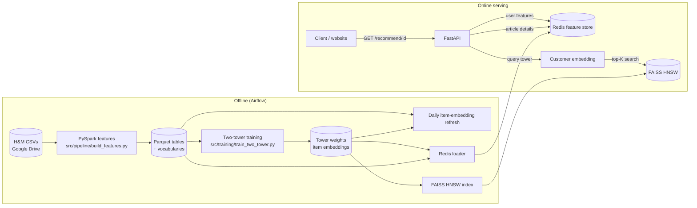

# H&M Context-Aware Neural Recommendation Engine

Two-tower deep learning recommender built on the H&M Personalized Fashion
Recommendations dataset. Uses customer metadata, purchase history, purchase
context and article metadata to give personalized top-12 recommendations.

**Tech stack:** Python, PySpark, TensorFlow / Keras, Redis, FastAPI, Apache Airflow

> The brief lists TensorFlow Recommenders (TFRS). The model is written in plain
> TensorFlow / Keras instead, because TFRS does not work well with the Keras 3
> version that Google Colab ships. The retrieval loss (in-batch softmax) is the same.

## Timeline
| Week | Work | Owner |
|------|------|-------|
| 1 | Data processing & feature engineering (PySpark) | afna kurikkal |
| 2 | Two-tower model training & evaluation | mariyaShaikh |
| 3 | Model export, Redis feature store, ANN search | team |
| 4 | FastAPI service, Airflow pipelines, load testing | team |

## Getting the data
1. Get a Kaggle API token (Kaggle → Settings → API → Create New Token).
2. Open `notebooks/week1_data_processing_final.ipynb` in Google Colab.
3. Run all cells. It downloads the data (only if missing) into
   `MyDrive/hm_project/` and creates all processed files.

Processed data is shared in Google Drive: <https://drive.google.com/drive/folders/1g7vdWBCzeLz01PtZKgRqC0-OtCwYVptW?usp=drive_link>

> Never commit `kaggle.json`, data files or model weights. They are blocked by `.gitignore`.

## Week 1 output files
All in `MyDrive/hm_project/`. **Index `0` = unknown user/item (cold-start).**
Train = before 2020-09-16, test = last week (2020-09-16 to 2020-09-22).

| File | Columns | Used for |
|------|---------|----------|
| `interactions_train.parquet` | user_idx, item_idx, t_dat, month, day_of_week, days_ago, price, sales_channel_id | Model training |
| `interactions_test.parquet` | user_idx, item_idx, t_dat, price, sales_channel_id | Evaluation (Recall@K, NDCG) |
| `user_table.parquet` | customer_id, user_idx, age, club_member_status, fashion_news_frequency, age_missing, n_purchases, n_unique_items, avg_price, days_since_last_purchase, is_new_user | Query tower features |
| `item_table.parquet` | article_id, item_idx, product_type_name, colour_group_name, department_name, garment_group_name, purchases_last_7d, purchases_last_28d, purchases_all_time, is_new_item | Candidate tower features |
| `user_vocab.parquet` / `item_vocab.parquet` | real ID ↔ index | Mapping IDs to embeddings |
| `vocabularies.json` | category value lists | Category codes for the towers |
| `fallback_top12.json` | 12 popular article_ids | Cold-start fallback and baseline |

## Week 2: two-tower model
Notebook: `notebooks/week2_two_tower_model.ipynb` (run in Colab after Week 1).

- **Query tower:** customer ID, club status, news frequency, age, purchase history
  features, recency, new-customer flag, plus context (month, day of week)
- **Candidate tower:** article ID, product type, colour group, department, garment
  group, 7-day / 28-day / all-time popularity, new-article flag
- **Training:** in-batch negative sampling with logQ correction, early stopping on a
  validation week; IDs not seen in training share a trained "unknown" embedding
- **Evaluation:** test week 2020-09-16 to 2020-09-22, full catalogue, Recall@K,
  NDCG@K and MAP@12 compared with the popularity baseline

Results: see `artifacts/WEEK2_REPORT.md`.

Model files (Google Drive, `MyDrive/hm_project/week2_model/`):

| File | Contents |
|------|----------|
| `query_tower.weights.h5` / `candidate_tower.weights.h5` | Trained tower weights |
| `item_embeddings.npy` | One vector per article (row order = `item_ids.json`) |
| `item_ids.json` | article_id for each row of `item_embeddings.npy` |
| `trained_user_idx.npy` | user_idx values with a trained ID embedding (others use 0) |
| `model_config.json` | Model settings and feature normalisation values |
| `item_hnsw.index` | FAISS HNSW index (built in Week 3) |

## Week 3: model serving & feature store
- **Item vectors:** exported by Week 2 (`item_embeddings.npy`); refreshed daily by
  `src/serving/export_embeddings.py` with the trained candidate tower.
- **Redis feature store** (`src/serving/load_redis.py`):

  | Key | Type | Contents |
  |-----|------|----------|
  | `user:{customer_id}` | hash | model-ready features (`user_idx`, `club`, `news`, `user_num` as float32 bytes) + readable profile |
  | `item:{article_id}` | hash | pre-computed item vector (`vec`, float32 bytes) + product type, colour, department, garment group |
  | `fallback:top12` | string | most popular articles, for unknown customers |
  | `model:info` | hash | model cutoff, embedding size, load time |

- **ANN search** (`src/serving/ann_search.py`): FAISS HNSW index over the item vectors,
  benchmarked against exact search (recall@12 and speed-up printed when built).

## Week 4: API, pipelines & load testing
- **FastAPI service** (`src/api/main.py`), docs at `/docs`:

  | Endpoint | Description |
  |----------|-------------|
  | `GET /recommend/{customer_id}?k=12` | Redis features → query tower → FAISS top-K → article details |
  | `GET /similar/{article_id}?k=12` | Similar articles (item-to-item ANN search) |
  | `GET /health` | Redis status, items in the index |
  | `POST /admin/reload` | Reload the ANN index after a refresh (called by Airflow) |

  Unknown customers get the popular-items fallback; customers with no purchases get
  model recommendations from their profile features (shared "unknown" ID embedding).
- **Airflow** (`dags/hm_recommendation_dags.py`):
  - `hm_weekly_retraining`: build_features → train_two_tower → build_ann_index → load_feature_store → reload_api → api_smoke_test
  - `hm_daily_embedding_refresh`: build_features → refresh_item_embeddings → build_ann_index → load_feature_store → reload_api
- **Tests:** `tests/test_api.py` (pytest) and `tests/stress_test.py` (concurrent load: throughput, p50/p95/p99 latency).

## System architecture


## How to run the whole project (Google Colab)
1. `notebooks/week1_data_processing_final.ipynb` → Run all (features → `MyDrive/hm_project/`)
2. `notebooks/week2_two_tower_model.ipynb` → Run all (model → `MyDrive/hm_project/week2_model/`)
3. `notebooks/week3_week4_serving_demo.ipynb` → Run all (ANN index, Redis, API, tests, stress test, Airflow DAGs)

Run locally instead (Linux/macOS/WSL, Redis installed):
```bash
pip install -r requirements.txt
export HM_DATA_PATH=/path/to/hm_project
python -m src.serving.ann_search && python -m src.serving.load_redis
uvicorn src.api.main:app --port 8000
python -m pytest tests/test_api.py && python -m tests.stress_test
```

## Repo structure
```
notebooks/        Colab notebooks: Week 1 features, Week 2 model, Week 3+4 serving demo
src/config.py     Paths and settings (override with environment variables)
src/pipeline/     Week 1 Spark feature job (Airflow task)
src/data/         Feature encoding shared by training and serving
src/models/       Query tower, candidate tower, two-tower model, loader
src/training/     Week 2 training as a script (Airflow task)
src/serving/      Week 3: ANN index, Redis feature store, daily embedding refresh
src/api/          Week 4: FastAPI service
dags/             Week 4: Airflow DAGs
tests/            API tests and stress test
artifacts/        Week 2 results: metrics, training history, report, sample recommendations
```
